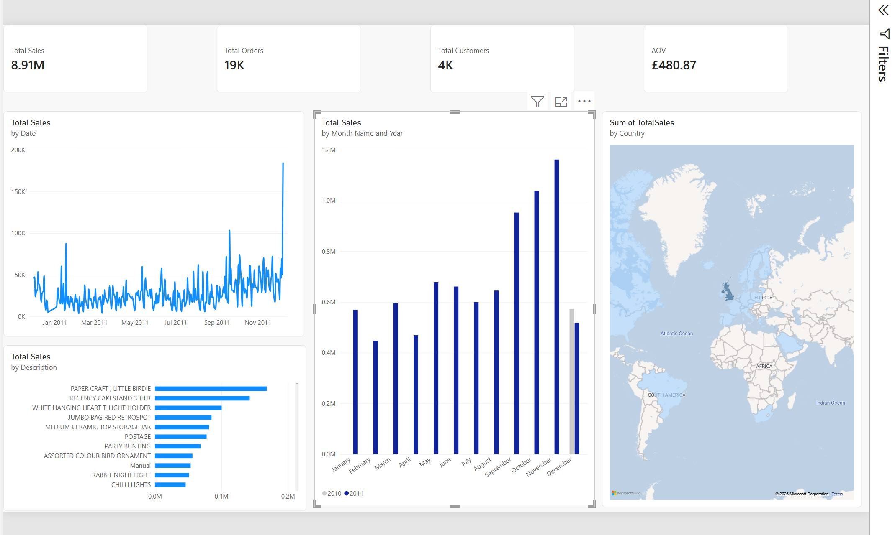

# Retail Sales Executive Dashboard - Power BI

### Business Problem
Analysed £8.91M UK retail sales across 38 countries.

### KPIs
Total Sales £8.91M | Orders 19K | Customers 4K | AOV £480.87

### Key Insights
1. 82% revenue from UK - high risk concentration
2. Q4 drives 45% revenue, Nov 2011 peak 1.16M
3. Top product: PAPER CRAFT, LITTLE BIRDIE
4. Daily sales volatile with Dec spikes

### Tools
Power BI Desktop, 【entity-DAX¦canonical_name=DAX】, Power Query, Maps (Filled Map with Gradient)

### Files
- retail_online_sales.pbix - Power BI file
- dashboard.png - Screenshot

Author: Swetha Seelam/Aspiring Business/Data Analyst
